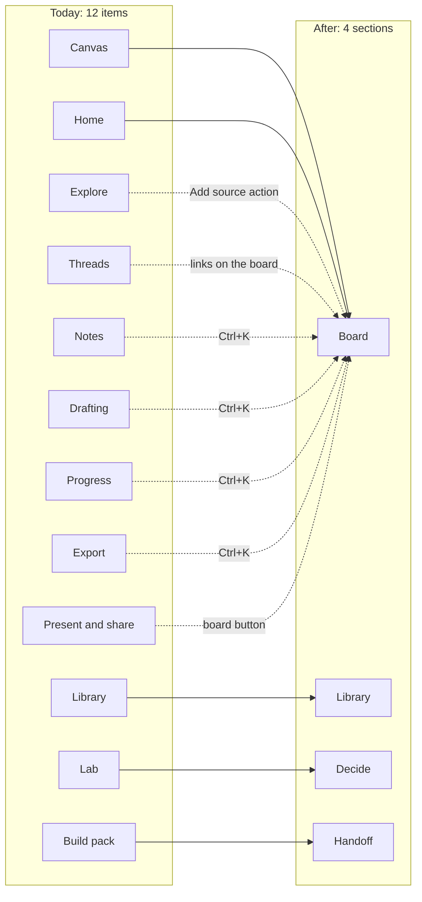

# Daiku v2: what changes, what might change, and what stays

*Nov 10, 2026 · explainer for people reading the plan, not instructions for Claude*

This explains the Daiku v2 redesign in plain terms: what has to change, what might change, what stays the same,
and the decisions still open. It covers three pieces of work:

1. **The redesign:** fewer sections, a pack tray, and a sleek liquid glass look
2. **A new sample project:** *ESP32 Node Programmer*, which replaces the chair example on first launch
3. **The ESP32 node programmer itself:** a separate app that the sample project plans and Claude builds

The instructions Claude follows are in `REDESIGN_PROMPT.md` (flows, build order) and `DAIKU_V2_GLASS_PROMPT.md`
(look, resources, sample, node app). This file explains them. The Word version without the glass and ESP32 parts is
`Daiku Redesign Explainer.docx` in Downloads.

---

## Contents

1. [In one paragraph](#1-in-one-paragraph)
2. [How to read this](#2-how-to-read-this)
3. [At a glance](#3-at-a-glance)
4. [Why it changes: the principles](#4-why-it-changes-the-principles)
5. [Must change: navigation and layout](#5-must-change-navigation-and-layout)
6. [Must change: the core flows](#6-must-change-the-core-flows)
7. [Must change: the liquid glass look](#7-must-change-the-liquid-glass-look)
8. [Resource audit: keep, improve, remove](#8-resource-audit-keep-improve-remove)
9. [The new sample project: ESP32 Node Programmer](#9-the-new-sample-project-esp32-node-programmer)
10. [The ESP32 node programmer app](#10-the-esp32-node-programmer-app)
11. [Might change](#11-might-change)
12. [Conflicts to decide](#12-conflicts-to-decide)
13. [Stays the same](#13-stays-the-same)
14. [Risks](#14-risks)
15. [Order and checkpoints](#15-order-and-checkpoints)
16. [Glossary](#16-glossary)

---

## 1. In one paragraph

Daiku keeps its data and logic and changes how people move through it and how it looks. Today the sidebar has
**12 places to go**. After the redesign there are **4: Board, Library, Decide and Handoff**, plus a reader panel on the
right and a pack tray along the bottom that always shows what Claude will receive. The look moves from soft and
rounded to **sleek liquid glass**: controls float on frosted, translucent layers, and content (cards, text, code)
stays on solid surfaces so it's easy to read. The old chair example is replaced by an **ESP32 Node Programmer**
project that shows every flow. That project's pack is the brief for a separate app: a visual node editor that turns
wired blocks into firmware for an ESP32 board.

## 2. How to read this

Every change is in one of four groups:

| Group | Meaning |
|---|---|
| **Must change** | The plan doesn't work without it |
| **Might change** | Depends on a decision, or on what the first usability tests show |
| **Conflict** | The plan and the current code or brand disagree; someone has to pick |
| **Stays** | Not touched, or only touched to keep it working |

In the resource audit, each item is marked **Keep**, **Improve**, **Remove** (taken out of the product, archived
first) or **Add**.

## 3. At a glance

| Area | Today | After v2 | Group |
|---|---|---|---|
| Navigation | 12 sidebar items, Ctrl 1–9 to jump | 4 sections, everything else in Ctrl+K | Must |
| Home | Its own screen | The board is home; "Start here" becomes the sample project | Must |
| Reader | Full page (`/reader/:assetId`) | Side panel over the board | Must |
| Claims | Screen under Explore | Card type on the board, filter in Library | Must |
| Threads | Separate graph screen | Links drawn between cards on the board | Must |
| Explore | Screen with a built-in browser | "Add source" action (Ctrl+K, paste, drop) | Must |
| Pack | Build pack screen plus Send to Claude | One Handoff screen plus a pack tray everywhere | Must |
| Review | Doesn't exist | New: the AI's answer checked against the brief | Must |
| Look | Warm, rounded, Comfortaa, flat | Sleek liquid glass, Geist or Inter, Mica window | Must |
| Fonts | Fraunces, Comfortaa, DM Mono | Fraunces kept for display; new UI sans and mono | Might |
| Backdrops | 8 to choose from | Trimmed to those readable behind glass, plus Mica | Must |
| Sample | Chair base decision (furniture) | ESP32 Node Programmer | Must |
| Token count | Characters ÷ 4 | Same offline; real count from the API online | Must |
| Data and rules | Store, SQLite, shared functions | Same | Stays |

## 4. Why it changes: the principles

The redesign follows principles in two groups. When two disagree, the earlier one wins.

### Principles for an AI tool
| # | Principle | What it looks like in Daiku |
|---|---|---|
| 1 | **Show what the AI will see** | Pack tray on every screen; "Preview as AI sees it" in Handoff |
| 2 | **Sources on everything** | Claims, scores and even node defaults link to where they came from |
| 3 | **The person decides** | AI summaries, tags and Claude's write-back arrive as proposals to accept or reject |
| 4 | **Show uncertainty** | "Estimate" on rough token counts, "guess" on unsourced scores, "summary" on AI summaries |
| 5 | **Make cost visible** | Tokens per pack and tokens saved, shown as numbers like a receipt |
| 6 | **AI actions can be undone** | Everything goes through the same Ctrl+Z |
| 7 | **Show progress as it happens** | Shimmer while a PDF is read; a live log while firmware compiles |

### Principles for software in general
| # | Principle | Source | What it looks like in Daiku |
|---|---|---|---|
| 8 | Content first, chrome second | Apple, Things 3 | Glass only for controls; content stays solid |
| 9 | Fewer choices | Hick's law | 4 sections; the palette for the rest |
| 10 | Recognition over recall | Nielsen | Ctrl+K lists every action with its shortcut |
| 11 | Direct manipulation | Shneiderman | Drag a card to the tray, a wire between nodes |
| 12 | Show system status | Nielsen | "Saved", token meter, compile progress |
| 13 | Forgiveness | Gmail's Undo send | Undo toasts instead of "are you sure?" |
| 14 | Work like other apps | Jakob's law | Standard shortcuts and drag and drop |
| 15 | Feel instant | Doherty threshold (~400 ms) | Show the change first, save in the background |
| 16 | Accessible by default | WCAG AA | 4.5:1 contrast on glass too; never colour alone |
| 17 | As little design as possible | Dieter Rams | A border, shadow or blur stays only if it explains something |

## 5. Must change: navigation and layout

### 12 sidebar items become 4 sections



| Today | Becomes | How you reach it |
|---|---|---|
| Home | Board | Opening a project lands on its board |
| Canvas | **Board** | Sidebar |
| Library | **Library** | Sidebar |
| Lab | **Decide** | Sidebar |
| Build pack + Send to Claude | **Handoff** | Sidebar, or Ctrl+Enter |
| Explore | Add source | Ctrl+K, paste, drop |
| Threads | Links on the board | Ctrl+K "Show links" |
| Reader | Side panel | Click any source |
| Claims | Card type and Library filter | Board, Library |
| Notes, Drafting | Unchanged pages | Ctrl+K |
| Progress, Export | Unchanged pages | Ctrl+K, and Export also in Handoff |
| Present and share | Board action | Button on the board |

Nothing here deletes a feature. Old addresses like `/canvas` or `/lab` **redirect** to the new ones, so links and the
"open where I left off" setting keep working. Searching an old name in Ctrl+K (for example "Threads") still finds it.

### The new layout

```
┌──────────┬───────────────────────────────────────┬──────────────┐
│ Sidebar  │                                       │  Reader      │
│ (glass)  │              Board                    │  panel       │
│          │         (solid canvas, cards)         │  (glass      │
│ Board    │                                       │   frame,     │
│ Library  │                                       │   solid      │
│ Decide   │                                       │   page)      │
│ Handoff  │                                       │              │
├──────────┴───────────────────────────────────────┴──────────────┤
│ Pack tray (glass): ● 12 items · 18.4k / 40k tokens  [Handoff →] │
└─────────────────────────────────────────────────────────────────┘
```

- **Sidebar:** 4 sections and the project switcher; collapses to icons.
- **Board:** home. Cards show their state at a glance.
- **Reader panel:** opens when you click a source, closes with Esc.
- **Pack tray:** always visible; drop cards on it to include them.

### Files touched
`src/app/App.tsx` (the nav list and routes), `src/app/CommandPalette.tsx`, `src/app/ShortcutsHelp.tsx`,
`src/features/reader/Reader.tsx`, `src/features/pack/Pack.tsx` and `SendToClaude.tsx` (merged into Handoff).

## 6. Must change: the core flows

| Flow | What the person does | What's new |
|---|---|---|
| **Capture** | Paste a link or drop a PDF anywhere | Works everywhere, not just Explore; loading shimmer; credits filled in automatically |
| **Read and claim** | Click a source, select text, "Make claim" | Reader is a side panel; floating toolbar; claim cards jump back to the passage |
| **Decide** | Compare options in a table | Live ranking with animation; unsourced scores clearly shown as guesses |
| **Hand off** | Open Handoff, fill the brief, preview, copy | Pinned / Included / Left out groups with reasons; token budget bar; exact preview |
| **Review** | Paste Claude's answer back | **New:** each must-have marked met / partly / unmet; one click starts a revision pack |

### The pack, in detail
- **Brief:** goal, audience, must-haves, done-when. Pre-filled from the last pack.
- **Three groups:** *Pinned* (always sent), *Included* (sent if the budget allows), *Left out* (with a reason such as "over budget" or "low weight").
- **Budget bar:** tokens by group, labelled with the model it was counted for. Over budget it turns amber and names the problem instead of silently dropping things.
- **Token count:** today it's characters ÷ 4 (`src/lib/claudePack.ts`). Offline that stays, labelled "estimate". Online it uses Anthropic's count-tokens API.
- **Same exit:** Handoff still saves and copies through `handOff.ts`, so nothing about the output format breaks.

### Shortcuts
| Shortcut | Action | Status |
|---|---|---|
| Ctrl+K | Command palette | Exists, gains every action |
| Ctrl+N | New card | New |
| Ctrl+Enter | Open Handoff | New |
| P | Pin or unpin the selected card | New (only when a card is selected and no text box has focus) |
| Space | Quick preview | New (mustn't clash with Space-to-pan) |
| Ctrl+Z / Ctrl+Shift+Z | Undo / redo | Ctrl+Shift+Z added; **Ctrl+Y stays** |
| Ctrl 1–4 | Jump to a section | Changes from Ctrl 1–9 |
| ? | All shortcuts | Exists |

## 7. Must change: the liquid glass look

### The idea
A dark, quiet workspace where controls float on layers of frosted glass above solid content. It should feel
precise and light, like a professional tool, with no decoration. "Liquid glass" means three things:

1. **Real translucency:** what's behind a panel shows through, blurred
2. **A thin bright edge** along the top of each glass layer, like light catching glass
3. **Fluid motion:** panels and the tray slide with a gentle spring, not a stiff linear move

### Two layers that never mix
| Layer | What's on it | Material | Why |
|---|---|---|---|
| **Content** | Board canvas, cards, reading text, Decide table cells, code, node bodies | Solid | Text over blur is hard to read and slow to draw |
| **Controls** | Sidebar, pack tray, palette, Reader frame, toolbars, menus, inspector, toasts | Glass | Shows they float above the work and can be moved past |

### Glass levels
| Level | Used for | Blur (starting value) | Opacity of the tint |
|---|---|---|---|
| Window base | The whole window | Windows **Mica** (the desktop shows through, softly) | n/a |
| Glass 1 | Sidebar, pack tray | 20 px | ~62 % |
| Glass 2 | Palette, Reader frame, inspector | 28 px | ~72 % |
| Glass 3 | Menus, tooltips, toasts | 16 px | ~82 % |
| Solid fallback | When transparency is off | none | 100 % |

These start values get tuned by eye and by a contrast check. If text on glass isn't readable, the tint gets
stronger; the blur doesn't get weaker.

### How it works on Windows
- **Mica** is a Windows 11 material that tints the window with your desktop colours. Daiku turns it on with Tauri's window effects.
- **Windows 10** doesn't have Mica, so Daiku falls back to a solid background there.
- If you turn off *Transparency effects* in Windows settings, Daiku follows it.
- **Settings → Appearance** gets a "Reduce transparency" switch that makes every glass layer solid.

### Speed limits
Blur costs graphics power, especially over a moving canvas.
- At most 3 blurred layers on screen at once
- If panning drops below 60 fps, glass over the canvas turns solid while moving and comes back when you stop
- Target: 60 fps panning a 300-card board on an ordinary laptop

### Colour
Grey and neutral, with colour used **only to show state**:

| State | Look | Colour |
|---|---|---|
| Sourced | Solid border plus source chip | Sage |
| Guess | Dashed border, italic, "guess" label | Clay |
| Conflict | Amber outline plus warning icon | New amber |
| In pack | Small dot in the corner | Accent |
| Left out | Dimmed, reason on hover | Grey (still readable) |
| Selected | Outline | One selection colour |

Every state also has a shape or a word, so it works without colour.

### Type
| Role | Today | Proposed |
|---|---|---|
| Interface | Comfortaa (rounded, friendly) | **Geist Sans** or **Inter** (neutral, tight, made for screens) |
| Data, credits, code | DM Mono | **Geist Mono**, or keep DM Mono |
| Titles, wordmark, big scores | Fraunces italic | **Keep, used rarely**; it adds warmth to the cool glass |
| Long reading | Fraunces | **Source Serif 4** or Fraunces at text size |

All are free fonts (SIL Open Font License). The switch is shown side by side before it's made.

### Motion
- Springs of 180–260 ms with almost no overshoot
- Glass fades its blur in as it appears instead of popping
- Buttons shrink slightly (98 %) when pressed
- With *Reduce motion* on, everything becomes a short fade

## 8. Resource audit: keep, improve, remove

Everything in the design package and sample data, with a verdict. **Remove** means archived to
`design/archive/` first, and deleted only after you say yes.

### Brand
| Resource | Verdict | Notes |
|---|---|---|
| Leaf "dk" monogram (all versions) | **Keep** | White version on dark glass |
| Wordmark "daiku." | **Keep** | Used rarely: title bar, About |
| Horizontal lockup | **Keep** | Installer and share pages |
| App icons | **Improve** | Add a frosted-tile version; same shape |
| Brand sheet | **Keep** | Redo after icon changes |

### Tokens and design code
| Resource | Verdict | Notes |
|---|---|---|
| `tokens.json` | **Improve** | Add glass levels, solid fallbacks, amber conflict, node port colours; fix the selection colour; finish dark mode (marked provisional today) |
| `tokens.css`, `tokens.ts` | **Improve** | Only regenerated from tokens.json |
| `global.css` | **Improve** | Remove hard-coded colours, add glass styles |
| `motion.css` | **Improve** | Shorter timings and springs; keep reduced-motion handling |
| `primitives.tsx` | **Improve** | Add glass panel, glass bar, chip, state badge, port |
| `Icon.tsx`, `MarkdownText`, `MathText` | **Keep** | |

### Icons (33, 24 px grid, 1.5 px stroke)
| Verdict | Notes |
|---|---|
| **Keep** | The thin stroke already looks sleek |
| **Improve** | Check sharpness at 16 px on glass |
| **Add** | Handoff, decide, pack tray, pin, review, link cards, source chip, node, port, wire, ESP32 chip, upload, serial, Wi-Fi, GPIO |
| **Remove** | Only icons used by nothing after the redesign; checked first |

### Pictures and backdrops
| Resource | Verdict | Notes |
|---|---|---|
| 13 furniture illustrations (oak, walnut, bouclé, chair…) | **Remove** (archive) | Belonged to the chair sample |
| 8 backdrops | **Improve and trim** | Keep quiet ones readable behind glass (likely graphite, nocturne, paper, maybe blueprint); archive loud ones; Mica becomes the default |
| `public/samples/chair.stl`, `study.pdf` | **Remove** (archive) | The CAD viewer feature stays |
| v2 screens | **Keep** | Still the layout reference |
| v1 and dark screens | **Archive** | Superseded |
| Wireframes | **Keep** | For copy and flows |

**Picture rule:** sample pictures must be real images from the web (official product photos, datasheet figures,
docs screenshots) with credit and licence, never generated. If a picture can't be bundled, Daiku stores the link and
fetches it on first open.

### Sample data
| Resource | Verdict | Notes |
|---|---|---|
| Chair sample (`seed.ts`) | **Replace** | With the ESP32 sample; its structure is the pattern |
| AI agent look board (`seedAgents.ts`) | **Might remove** | Off first launch; maybe "More examples" in Ctrl+K |
| `is_sample` flags, `withoutSamples()` | **Keep** | The new sample uses them |

## 9. The new sample project: ESP32 Node Programmer

### Why this example
- It's a real project a builder might do, so it isn't just filler
- It has hard facts (pin limits from a datasheet) to make **sourced** claims, and opinions to show **guesses**
- It has a real choice to **decide** (which code language first)
- Its pack is a real brief Claude can **build** from, and the result can be **reviewed**

So one small project shows the whole loop: capture → claim → decide → hand off → review.

### What's in it
**Board regions:** Hardware, Editor, Code generation, Decisions, Brief.

**5 sources** (real, credited, fetched from the web):
| # | Source | Why it's there |
|---|---|---|
| 1 | Espressif *ESP32 Series Datasheet* | Pin facts |
| 2 | Espressif *ESP-IDF Programming Guide* (GPIO, PWM) | Wi-Fi and ADC limits |
| 3 | *Arduino core for the ESP32* docs | The code target |
| 4 | *React Flow* docs | The node editor library |
| 5 | *arduino-cli* docs | Compiling and uploading |

**3 claims:**
| Claim | State |
|---|---|
| GPIO 34–39 are input only | Sourced (datasheet) |
| ADC2 pins can't be used while Wi-Fi is on | Sourced (ESP-IDF docs) |
| Beginners prefer Arduino-style code over ESP-IDF | **Guess**, so the dashed look shows up on purpose |

**1 decision: "Which code target first?"**
Options: Arduino C++, ESP-IDF C, MicroPython. Criteria: beginner-friendly (35 %), library coverage (25 %),
Windows build tools (20 %), speed (10 %), room to grow (10 %). The scores are labelled as sample data; some are backed
by sources and some are guesses, so both looks appear.

**1 pack: "Build the node editor MVP"**
- **Goal:** a desktop node editor that turns a graph into an Arduino sketch and uploads it to an ESP32
- **Audience:** makers who know what a pin is but not C++
- **Must-haves:** typed ports, pin checks, code preview, one-click upload, serial monitor
- **Done when:** the "blink plus button" and "sensor to MQTT" examples run on a real board
- **Groups:** Pinned (the two sourced claims, the decision), Included (sources 1, 3, 4, 5), Left out (source 2's full PDF: "over budget, summary included instead")

**Review example:** a sample answer beside the brief with must-haves marked, so the Review screen isn't empty on
first launch.

### What changes in code
- New `src/data/seedEsp32.ts`, every row marked as sample
- First launch opens this project
- Tests that expect the chair numbers (A 3.75, B 3.70, C 3.35) get updated to the new sample

## 10. The ESP32 node programmer app

This is the app the sample project plans. It's a **separate project** (`esp32-node-programmer/`) in the same glass
style, built after Daiku v2 and only when you say go.

### What it does
You drag blocks ("nodes") like *Button*, *LED*, *Every 500 ms*, *Wi-Fi* and *MQTT Publish*, connect them with wires,
and the app:
1. Checks the wiring and the pins as you go
2. Writes a readable Arduino sketch you can see beside the graph
3. Compiles it and uploads it to the ESP32 over USB
4. Shows what the board prints in a serial monitor

### How it's built
| Part | Choice |
|---|---|
| App shell | Tauri 2, React, TypeScript (same as Daiku) |
| Node editor | React Flow (MIT licence) |
| Compile and upload | `arduino-cli` bundled with the app |
| Serial monitor | Rust `serialport` library |
| Code view | CodeMirror 6, read-only |

### Key ideas
| Idea | In plain words |
|---|---|
| **Typed ports** | Each plug has a type (on/off, analog, number, text, event). Wrong plugs won't connect, and it says why. Each type has a colour and a shape. |
| **Events and values** | Event wires say *when* to run ("every 500 ms", "when pressed"); other wires carry *values* |
| **No freezing** | Generated code never uses `delay()`, so the board can do several things at once |
| **Pin checks** | Warns or blocks unsafe pins, such as flash pins, input-only pins, boot pins, the ADC2-with-Wi-Fi limit and two nodes on one pin. Each rule is checked against the datasheet and cited. |
| **Traceable code** | Click a line of code to see the node that made it, and the other way round |
| **Same graph, same code** | The output is predictable, so it can be tested |
| **Secrets stay secret** | Wi-Fi passwords never go into the graph, the code file, logs or a Daiku pack |

### First 24 nodes
| Group | Nodes |
|---|---|
| Board | Digital in, digital out, analog in, PWM out, touch in |
| Timing | On start, every N ms, delay, debounce |
| Logic and maths | Compare, AND/OR/NOT, toggle, map range, threshold, counter |
| Sensors | Button, DHT22, BME280 |
| Actuators | LED, servo, relay |
| Connectivity | Wi-Fi connect, MQTT publish, MQTT subscribe |
| Debug | Serial print |

### Milestones
| # | Build | Done when |
|---|---|---|
| 1 | App shell, canvas, node library, save and open | A graph reopens exactly |
| 2 | Typed ports and 10 core nodes | Wrong wires are refused with a reason |
| 3 | Pin checks for the ESP32 DevKitC | Every rule has a test |
| 4 | Code generation and code panel | The 4 examples match saved snapshots |
| 5 | Compile, upload, serial | "Blink" runs on a real board |
| 6 | All 24 nodes, Wi-Fi and MQTT | "Sensor → MQTT" publishes to a test server |
| 7 | Polish | Accessibility and design reviews pass |

## 11. Might change

| Item | What it depends on |
|---|---|
| Home screen | Probably gone as a section; maybe a small project picker for people with many projects |
| Explore browser | Kept; opens from "Add source" as a panel, window or page (not decided) |
| Threads graph | Links move onto the board; the full graph may stay in Ctrl+K for big projects |
| Engineering views (Requirements, BOM, Simulate, CAD) | Not in the concept; likely reached from a decision |
| Notes, Drafting, Deck | Kept and reached from Ctrl+K unless you decide otherwise |
| Fonts | Geist or Inter; decided after seeing them side by side |
| AI agent sample | Removed from first launch; kept as an extra example or archived |
| Database | Pins, left-out reasons, pack history and reviews may need a new migration (`004_…`); old ones stay |
| Real token count | Needs internet and an API key; the estimate stays as fallback |
| Mac build | Moves up only if the design agency pilot uses Mac |
| Node app inside Daiku | It's planned as a separate app; a later "Send graph to Daiku" button could link them |

## 12. Conflicts to decide

Found by checking the plan against the code and brand files. Claude is told to ask before picking.

| # | Conflict | Options |
|---|---|---|
| 1 | **Sage does two jobs.** It's the accent for buttons and focus, and also means "sourced". The concept says colour should only mean state. | (a) Neutral accent, sage only for brand and sourced (**recommended**) · (b) Keep sage as accent; show sourced by chip and border only |
| 2 | **Selection colour mismatch.** Brand rules say lilac `#8F82CF`; `tokens.json` says blue `#4F74A8`. | Pick one and update the other |
| 3 | **No amber exists.** Conflicts and over-budget need one that can't be confused with clay (guesses). | Add a new `conflict` token, checked in light and dark |
| 4 | **Comfortaa vs sleek.** Rounded type works against the glass look. | Geist or Inter for UI; Fraunces kept for display |
| 5 | **Calm vs glass.** The concept wants calm and content first; glass can get busy. | Glass only on controls, at most 3 layers, solid content |
| 6 | **Ctrl+Y vs Ctrl+Shift+Z for redo.** | Keep both |

## 13. Stays the same

- **Data:** the store (`src/data/store.ts`), SQLite or browser storage (`repo.ts`), types and existing records
- **Shared rules:** `isCredited()`, `withConsentOnly()`, `withoutSamples()`, `narrowToProject()`, `focusPlan()`, `applyPlan()`, `weightedTotals()`, `saveBytes()`, `savePack()`, `copyPack()`
- **Rust side:** the Explore browser pane, library files, OCR, ink, file conversion, appearance files
- **Canvas engine:** drawing, handwriting, maths recognition, connectors, undo. Only card looks and drop zones change.
- **Brand core:** the logo, the wordmark, clay meaning guesses, butter-yellow sticky notes
- **Install and release:** `Install Daiku.cmd`, `install.ps1`, the installer, update setup, the GitHub workflow

## 14. Risks

| Risk | What to do |
|---|---|
| Glass makes text hard to read | Glass only on controls; 4.5:1 contrast check over every backdrop; Reduce transparency switch |
| Glass is slow on cheap laptops | At most 3 blurred layers; turn solid while panning; test on integrated graphics |
| Glass looks wrong on Windows 10 | Solid fallback, tested on purpose |
| The sidebar change breaks habits and tests at once | Do it alone first, with redirects and updated tests |
| Hidden screens feel like lost features | Every one stays findable by its old name in Ctrl+K |
| The pack tray eats board space | One line high, collapsible |
| Single-key shortcuts (P, Space) fire while typing | Only active when a card is selected and no text box has focus |
| The sample quotes something wrong | Quotes are taken from the real source pages, not written from memory |
| The node app grows too big | It's separate, and only starts after Daiku v2 and your go-ahead |
| Wi-Fi passwords leak into packs | Kept outside graphs, code, logs and packs by design |
| Doing too much before testing with people | Stop after step 4 and test with 5 builders first |

## 15. Order and checkpoints

| Step | Build | Check before moving on |
|---|---|---|
| A0 | Audit list of every resource with its verdict; no changes yet | You approve it |
| A1 | New tokens (glass, amber, ports, fixes); font options side by side | Contrast passes in light and dark |
| A2 | Mica window, fallbacks, Reduce transparency switch | Works on Windows 11 and falls back cleanly |
| A3 | Glass sidebar, title bar, palette, toasts | Design critique of screenshots |
| 1 | 4 sections, Saved indicator, redirects | All old links work; tests pass |
| 2 | Paste and drop anywhere, source cards, Library list | Works in the desktop app |
| 3 | Reader panel, claims from selected text | A claim jumps back to its passage |
| 4 | Pack tray and Handoff | **Usability test with 5 builders** |
| 5 | Sourced, guess, conflict and left-out looks | Accessibility check |
| 6 | Decide table with live ranking | Matches today's scoring exactly |
| 7 | Review screen | A revision pack carries the unmet items |
| 8 | Polish: empty states, shortcuts sheet, dark mode, compact mode | Full checks |
| A9 | Archive approved resources; ship the ESP32 sample | No broken imports; samples still excluded from exports |
| C1–C7 | ESP32 node programmer app (separate) | Only after your go-ahead |

Every step also runs the linter, unit tests, click-through tests and Rust tests, and comes with screenshots in light
and dark.

## 16. Glossary

| Term | Meaning |
|---|---|
| **Pack** | The bundle of brief, sources, claims and decisions Daiku sends to Claude |
| **Pack tray** | The bar along the bottom showing what's in the pack and its size |
| **Handoff** | The screen where you build and check the pack |
| **Claim** | A statement backed (or not yet backed) by a passage from a source |
| **Sourced / guess** | Backed by evidence / not yet backed |
| **Token** | The unit Claude counts text in; plans have limits on them |
| **Liquid glass** | Translucent, blurred panels with a bright edge and fluid motion |
| **Mica** | A Windows 11 window material that softly shows your desktop colours |
| **Node** | A block in the ESP32 editor, such as a button, LED or timer |
| **Port / wire** | A plug on a node / a connection between two plugs |
| **GPIO** | A general-purpose pin on the ESP32 |
| **Sketch** | An Arduino program |
| **arduino-cli** | Arduino's command-line tool for compiling and uploading |
| **MQTT** | A small messaging protocol often used by sensors |
