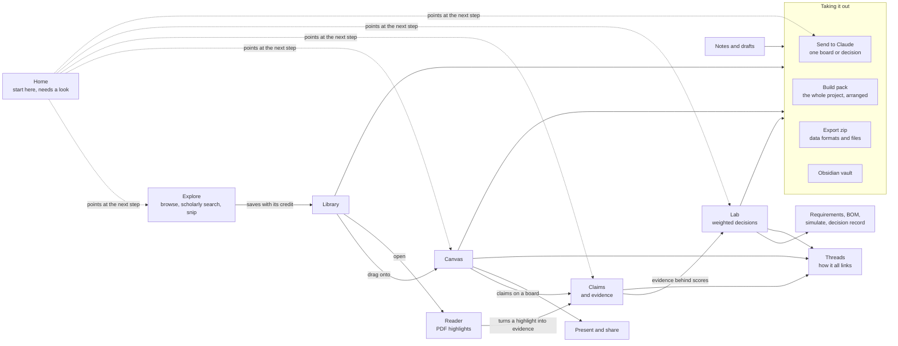

# Daiku's features and how they connect

Everything sits on one local store (`src/data/store.ts`, the most connected part of the code). The features below read
and write it, and a handful of shared rules travel with the data wherever it goes. The connections here come from the
code graph in `graphify-out/` (`graph.html` to explore it).

## The research loop

## Features

| Feature | What it does | Feeds | Fed by |
|---|---|---|---|
| **Home** | Recent boards, "needs a look", and the five-step **Start here** checklist | every screen it links to | claims, scores, comments, your own (non-sample) work |
| **Explore** | Built-in browser, scholarly search, screen snip | Library | the web |
| **Library** | Your files as normal files, text and colour search, code with its licence | Canvas, Reader, Lab concepts, every export | Explore, Import, Settings' library folder |
| **Reader** | PDFs with highlights | Claims (a highlight becomes evidence) | Library |
| **Canvas** | Boards: pictures, notes, sections, drawings, connectors | Claims, Share, Threads, Send to Claude, exports | Library |
| **Claims** | Statements, each backed or challenged by sources | Lab, Threads, Home's "needs a look" | Canvas, Reader |
| **Lab** | Weighted decision matrix; unsourced scores stay guesses | Requirements, BOM, Simulate, Decision record, Send to Claude | Claims' evidence, Library pictures |
| **Threads** | A map of how everything links, with unsupported items flagged | Build pack and Send to Claude (`Map.md`, `map.json`), Export (the graph files) | Canvas, Claims, Lab |
| **Notes, drafts, decks** | Writing from the research, with citations | Build pack, exports | Library, Claims |
| **Progress** | Milestones, saved checks, heat maps, the workflow log | Build pack | every change (the log) |
| **Share** | Present a board, comment, export one page | (a page or a PDF) | Canvas |
| **Send to Claude** *(new)* | One board or decision, with its sources and claims, as paste-ready text or a zip | Home's last step | Canvas, Lab |
| **Build pack** | The whole project for Claude, arranged into groups with your instructions | (a zip or the clipboard) | everything |
| **Export** | Data in standard formats plus your files, one zip | (a zip) | everything |
| **Settings** | Appearance, library folder, Obsidian vault, **updates** *(new)* | the whole app | |

## Rules shared across features

These are single pieces of code that several features call, so a fix in one place holds everywhere:

| Rule | Code | Used by |
|---|---|---|
| Every source keeps its credit; uncredited ones are flagged | `isCredited()` | Canvas, Library, Share, Threads, Progress, Deck, every export and pack |
| Interview notes travel only with consent | `withConsentOnly()` | Build pack, Send to Claude, Export |
| Sample data stays out unless asked for | `withoutSamples()` | Build pack, Export, Start here |
| One project, board or decision alone | `narrowToProject()`, `projectAssetIds()`, `focusPlan()` | Export, Library, Send to Claude |
| Leaving something out removes it everywhere | `applyPlan()` | Build pack, Send to Claude |
| Scores and rankings | `weightedTotals()` | Lab, Deck, Export, Decision record, readiness |
| Saving a file the person picks | `saveBytes()` | Export, Build pack, Send to Claude, Settings, CAD, Deck |
| Handing a pack to Claude | `savePack()`, `copyPack()` in `features/pack/handOff.ts` | Build pack, Send to Claude |

## How the new features combine

- **Send to Claude** is not a second pack builder. `focusPlan()` works out what to leave out for one board or decision,
  using the same project scoping as Export, and the ordinary pack builder does the rest. Build pack and Send to Claude
  share `handOff.ts`, so both save and copy the same way, and both tick Home's last step.
- **Start here** stores nothing but that last flag. `firstRunSteps()` reads your own work (samples excluded), so a step
  ticks however you did it. It replaced the static "Collect → Arrange → …" strip and kept its Hide setting and its link
  to the example board.
- **Updates** use the update plugin that was installed but never switched on. It turns on only in a build made after
  `npm run updates:setup`; before that, Settings says plainly that updates aren't set up. Installing an update saves
  pending work first.
