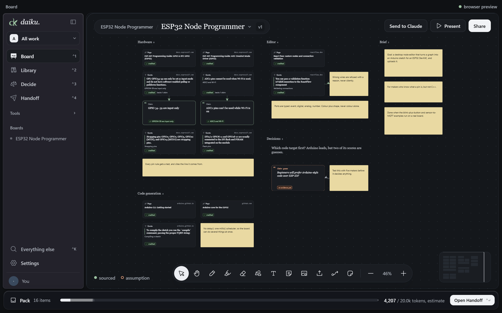
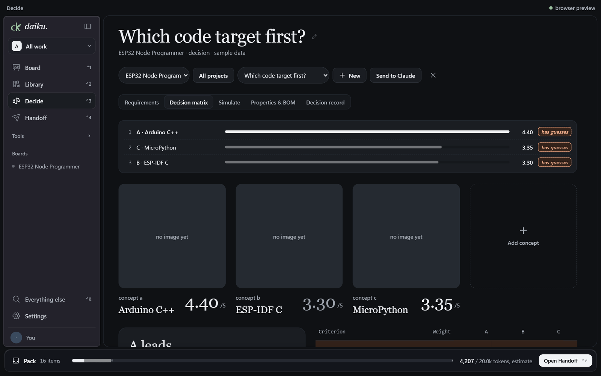
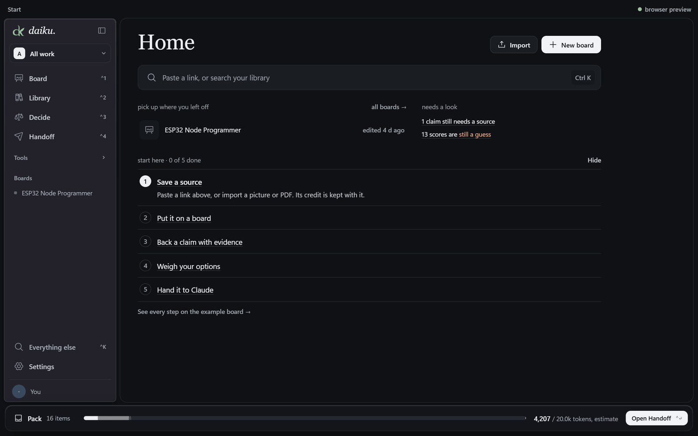

<p align="center">
  
</p>

<h1 align="center">Daiku</h1>

<p align="center">
  <b>A place where ideas take form.</b><br>
  Collect sources, lay them out on a board, and make decisions you can back up.<br>
  A local-first research and design workspace for Windows.
</p>

<p align="center">
  <a href="#install-it">Install</a> ·
  <a href="FEATURES.md">How it fits together</a> ·
  <a href="#run-it">Build from source</a>
</p>

<p align="center">
  
</p>

## Why Daiku

Research tends to scatter: a screenshot here, a PDF there, a decision made on a hunch nobody wrote down. Daiku keeps it
in one place and keeps it honest.

- **Every source keeps its credit.** Pictures, quotes and papers carry where they came from, and anything without a
  source is flagged.
- **Guesses stay marked as guesses.** A score with no evidence behind it is shown as a guess until you back it up.
- **It's yours.** Everything lives on your PC as normal files and a local database. No account, no cloud.
- **It hands off cleanly to AI.** Send a board or a decision to Claude with its sources, claims and full document text
  as Markdown.

## What's inside

| | |
|---|---|
| **Board** | An infinite whiteboard: pictures, stickies, sections, drawings, shapes and connectors, with undo. Zoom with a pinch or the scroll wheel, like FigJam. Drop in files and they become a folder of Markdown. |
| **Library** | Your files as normal files, with full-text and colour search. Code keeps its credit and licence, and is shown, never run. |
| **Explore** | A built-in browser and free scholarly search. Save images and papers with their source attached. |
| **Decide** | A weighted decision matrix, with requirements, a bill of materials, simulation and a decision record. It shows what would flip the result. |
| **Threads** | A map of how everything links, with unsupported claims flagged. |
| **Share** | Present a board, collect comments, or export one self-contained page. |
| **Handoff** | Send one board, one decision or the whole project to Claude: as text to paste, or a zip for a Claude project. PDFs and Word files go along as Markdown. |

<p align="center">
  
  
</p>

How the features connect: [FEATURES.md](FEATURES.md).


## Install it

**Got `Daiku-Setup-<version>.exe`?** Double-click it. Daiku installs in under a minute for your user only, with nothing
else to download. It isn't code-signed, so Windows asks you to confirm: "More info", then "Run anyway". The one extra
is the handwriting-maths reader (120 MB): it downloads the first time you read a formula, and stays on the PC after that.

### Give it to someone

Don't send them this folder: building it on a new PC downloads several GB of tools and takes half an hour or more.
Run `npm run share` instead. It builds the installer and puts `Daiku-Setup-<version>.exe` (about 120 MB) in `share\`,
then opens that folder. Send them that one file. Pushing a version tag to GitHub builds the same installer as a draft
release, so you can send a download link instead.

### Build it from source

Double-click **`Install Daiku.cmd`**. If a ready-made setup file is next to it, or in `share\`, it just runs that.
Otherwise it checks for Node.js, Rust, the Microsoft C++ build tools and WebView2, offers to install anything missing
with winget (it asks first), builds the app and runs the Daiku setup. On a new PC the tools are several GB and the
first build compiles Rust for 10 to 20 minutes.

From PowerShell: `powershell -ExecutionPolicy Bypass -File .\install.ps1` with `-BuildOnly` to only build the
installer, `-Share` to build it into `share\`, `-Rebuild` to build even when a setup file is there, `-Yes` to skip
the questions, or `-SkipChecks` on a machine that's already set up.

### Updates

Off until there's somewhere to update from. With a GitHub repo for releases, run once:

```
npm run updates:setup -- owner/repo
```

It makes a signing key in `~/.tauri` (never in the project), points the app at that repo's latest release, and says
which two secrets to add on GitHub. Copies built after that can update themselves from Settings.

## Run it

```
npm install
npm run tauri dev     # run the app (the first Rust build is slow)
npm run dev           # UI only, in a browser, with localStorage instead of SQLite
npm test              # unit tests
npm run test:e2e      # click-through tests in Edge
npm run lint
npm run tauri build   # installer: src-tauri/target/release/bundle/nsis/
cd src-tauri && cargo test --lib
```

## Layout

| Path | What |
|---|---|
| `src/app` | Shell, routing, title bar, command palette |
| `src/design` | Generated tokens (`npm run tokens`), `Icon`, primitives, global CSS |
| `src/features/*` | The app's screens |
| `src/data` | Types, store (zustand), repo (SQLite, or localStorage in a plain browser), sample data |
| `src/lib` | Pure logic: scoring, readiness, colour, search, web and capture parsing, scholarly APIs |
| `src-tauri/src/explore` | The Chromium browser pane and its capture script |
| `src-tauri/src/library.rs` | Library files, image download, scholarly proxy |
| `src-tauri/migrations` | SQLite schema |
| `e2e` | Playwright click-through tests; `e2e/native` checks the real app |

## Built with

[Tauri 2](https://tauri.app) and Rust for the desktop app, [React](https://react.dev) and TypeScript for the interface,
SQLite for storage, and [ONNX Runtime](https://onnxruntime.ai) to read handwritten maths on your PC. The maths model is
[Pix2Text MFR](https://huggingface.co/breezedeus/pix2text-mfr-1.5) by breezedeus (MIT licence). Icons are from
[Phosphor](https://phosphoricons.com) (MIT licence).

<p align="center"><sub>Built with care, one board at a time.</sub></p>
